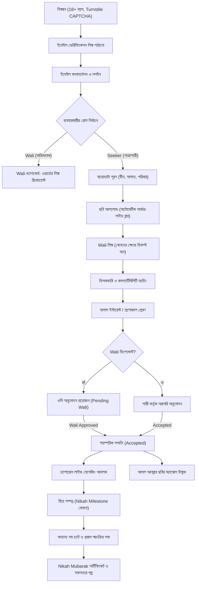
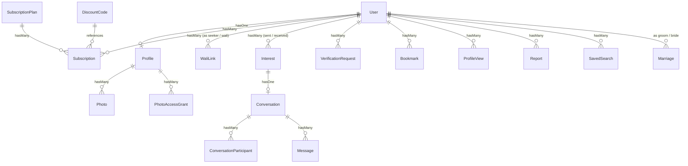

# 💍 Nikah Connect — সম্পূর্ণ সিস্টেম ডকুমেন্টেশন ও আর্কিটেকচারাল গাইডলাইন

> **নোট**: এই ডকুমেন্টটিতে Nikah Connect (Global Nikkah) প্ল্যাটফর্মের সমস্ত কার্যপ্রণালী, স্থাপত্য (Architecture), বিজনেস লজিক, ডাটাবেস স্কিমা, ইউজার রোল ও নিরাপত্তা ব্যবস্থার বিস্তারিত বিবরণ দেওয়া হয়েছে।

---

## 📑 সূচিপত্র (Table of Contents)
1. [সিস্টেম পরিচিতি ও মূল দর্শন (Vision & Core Philosophy)](#1-সিস্টেম-পরিচিতি-ও-মূল-দর্শন)
2. [প্রযুক্তি স্ট্যাক ও আর্কিটেকচার (Tech Stack & Architecture)](#2-প্রযুক্তি-স্ট্যাক-ও-আর্কিটেকচার)
3. [ইউজার রোল ও পারমিশন সিস্টেম (User Roles & Permissions)](#3-ইউজার-রোল-ও-পারমিশন-সিস্টেম)
4. [ব্যবহারকারীর সম্পূর্ণ জীবনচক্র (Complete User Lifecycle)](#4-ব্যবহারকারীর-সম্পূর্ণ-জীবনচক্র)
   - ৪.১ [নিবন্ধন ও বয়স যাচাই (Registration & Age Integrity)](#৪১-নিবন্ধন-ও-বয়স-যাচাই)
   - ৪.২ [ইমেইল ভেরিফিকেশন ও নিরাপত্তা (Email Verification)](#৪২-ইমেইল-ভেরিফিকেশন-ও-নিরাপত্তা)
   - ৪.৩ [প্রোফাইল তৈরি ও বায়োডাটা (Profile & Deen Completeness)](#৪৩-প্রোফাইল-তৈরি-ও-বায়োডাটা)
   - ৪.৪ [ফটো প্রাইভেসি ও সার্ভার-সাইড ব্লার (Modesty & Photo Protection)](#৪৪-ফটো-প্রাইভেসি-ও-সার্ভার-সাইড-ব্লার)
   - ৪.৫ [অভিভাবক বা ওলি সিস্টেম (Wali Guardian Workflow)](#৪৫-অভিভাবক-বা-ওলি-সিস্টেম)
   - ৪.৬ [ডিসকভারি ও দ্বীন-ভিত্তিক ম্যাচিং ইঞ্জিন (Matching Engine)](#৪৬-ডিসকভারি-ও-দ্বীন-ভিত্তিক-ম্যাচিং-ইঞ্জিন)
   - ৪.৭ [দৈনিক কোটা ও সাবস্ক্রিপশন প্ল্যান (Quotas & Tier Limits)](#৪৭-দৈনিক-কোটা-ও-সাবস্ক্রিপশন-প্ল্যান)
   - ৪.৮ [হালাল প্রপোজাল বা প্রস্তাব প্রেরণ (Interest Requests)](#৪৮-হালাল-প্রপোজাল-বা-প্রস্তাব-প্রেরণ)
   - ৪.৯ [চ্যাপারোন লাইভ মেসেজিং ও চ্যাট মডারেশন (Live Messaging & Chat Guard)](#৪৯-চ্যাপারোন-লাইভ-মেসেজিং-ও-চ্যাট-মডারেশন)
   - ৪.১০ [বুকমার্ক, পার্সোনাল নোট ও প্রোফাইল ভিজিটরস (Bookmarks & Visitors)](#৪১০-বুকমার্ক-পার্সোনাল-নোট-ও-প্রোফাইল-ভিজিটরস)
   - ৪.১১ [আইডেন্টিটি ভেরিফিকেশন ও কেওয়াইসি (Identity KYC Verification)](#৪১১-আইডেন্টিটি-ভেরিফিকেশন-ও-কেওয়াইসি)
   - ৪.১২ [রিপোর্টিং ও ব্লকিং মেকানিজম (Reporting & Blocking)](#৪১২-রিপোর্টিং-ও-ব্লকিং-মেকানিজম)
   - ৪.১৩ [নিকাহ মুবারক ও পোস্ট-নিকাহ অটোমেশন (Nikah Milestone & Auto-Close)](#৪১৩-নিকাহ-মুবারক-ও-পোস্ট-নিকাহ-অটোমেশন)
5. [প্যাকেজ ও সাবস্ক্রিপশন ইঞ্জিন (Subscription & Payments)](#5-প্যাকেজ-ও-সাবস্ক্রিপশন-ইঞ্জিন)
6. [অ্যাডমিন ও মডারেশন কনসোল (Admin & Governance Suite)](#6-অ্যাডমিন-ও-মডারেশন-কনসোল)
7. [ডাটাবেস মডেল ও রিলেশনশিপ (Database Models & Schema)](#7-ডাটাবেস-মডেল-ও-রিলেশনশিপ)
8. [রিয়েল-টাইম ইভেন্টস ও ব্রডকাস্টিং (WebSockets & Reverb)](#8-রিয়েল-টাইম-ইভেন্টস-ও-ব্রডকাস্টিং)
9. [রেস্টফুল এপিআই (REST API V1 - Sanctum)](#9-রেস্টফুল-এপিআই-rest-api-v1)
10. [নিরাপত্তা, প্রাইভেসি ও জিডিপিআর কমপ্লায়েন্স (Security & Compliance)](#10-নিরাপত্তা-প্রাইভেসি-ও-জিডিপিআর-কমপ্লায়েন্স)

---

## 1. সিস্টেম পরিচিতি ও মূল দর্শন

**Nikah Connect** (বা **Global Nikkah**) একটি শরীয়াহ-সম্মত, ইসলামিক বিবাহ ও পাত্র-পাত্রী খোঁজার (Matrimonial) প্ল্যাটফর্ম। প্রচলিত ডেটিং বা হুকআপ অ্যাপ্লিকেশনের মতো বাহ্যিক রূপ দেখে দ্রুত সোয়াইপ (Swipe) করার সংস্কৃতির বিপরীতে, এই সিস্টেমটি নির্মিত হয়েছে মুসলিম সমাজের পর্দা (হায়া), পারিবারিক সম্পৃক্ততা (ওলি/অভিভাবক প্রথা) এবং দ্বীনি সামঞ্জস্যতাকে অগ্রাধিকার দিয়ে।

### প্ল্যাটফর্মের মৌলিক স্তম্ভসমূহ:
1. **অভিভাবকের সক্রিয় ভূমিকা (Wali Involvement)**: পাত্রীর সম্মান ও নিরাপত্তা রক্ষায় পিতার বা মাহরাম অভিভাবকের অনুমোদন ছাড়া অনৈতিক যোগাযোগ রোধ করা।
2. **সার্ভার-সাইড পর্দা নিশ্চিতকরণ (Haya Protection)**: পাত্র-পাত্রীর মূল ছবি ডাটাবেসে সুরক্ষিত এবং সার্ভার-সাইডে ব্লার বা ঘোলাটে অবস্থায় রাখা হয়। পারস্পরিক সম্মতি এবং ওলির অনুমোদন ছাড়া মূল ছবি প্রকাশ পায় না।
3. **দ্বীন-কেন্দ্রিক ম্যাচমেকিং (Deen-First Matching)**: বাহ্যিক চাকচিক্যের চেয়ে ৫ ওয়াক্ত সালাত, মাযহাব, কুরআন তেলাওয়াত, হালাল খাদ্যাভ্যাস ও সুন্নাহর প্রতি গুরুত্ব দিয়ে স্কোরিং করা হয়।
4. **চ্যাপারোন বা অভিভাবক নজরদারি সম্পন্ন চ্যাট (Supervised Chat)**: যেকোনো ব্যক্তিগত যোগাযোগের মধ্যে ওলির নজরদারি থাকে এবং অযাচিত কন্টাক্ট নম্বর (WhatsApp, ফোন, ফেসবুক ইত্যাদি) আদান-প্রদান অ্যালগরিদমিকভাবে ব্লক করা হয়।
5. **এককালীন বিয়ে পর্যন্ত মেয়াদ (Active Until Nikah)**: সাধারণ মাসিক সাবস্ক্রিপশন শোষণের বদলে "বিয়ে হওয়া পর্যন্ত সক্রিয়" নীতিতে পরিচালিত।

---

## 2. প্রযুক্তি স্ট্যাক ও আর্কিটেকচার

* **ব্যাকএন্ড ফ্রেমওয়ার্ক**: Laravel 12.x / 13.x (PHP 8.3 / 8.4)
* **ডাটাবেস**: PostgreSQL 16 (প্রোডাকশন গ্রেড), MySQL 8.x এবং SQLite সাপোর্ট
* **ফ্রন্টএন্ড**: Laravel Blade টেমপ্লেটিং, Tailwind CSS v4, Alpine.js, Vite
* **রিয়েল-টাইম ব্রডকাস্টিং**: Laravel Reverb (ফার্স্ট পার্টি হাই-স্পিড ওয়েব-সকেট সার্ভার) + Laravel Echo
* **এপিআই ও অথেন্টিকেশন**: Laravel Sanctum (Bearer Token)
* **পেমেন্ট গেটওয়ে**: 
  - Stripe (Checkout Sessions ও Webhook)
  - PayPal REST API (v2 Orders, Capture ও Webhook)
  - Simulated Developer Gateway (লোকাল টেস্টিং ও ডেমো মোড)
* **ক্যাপচা ও বট প্রোটেকশন**: Cloudflare Turnstile CAPTCHA
* **ইমেজ প্রসেসিং**: PHP GD লাইব্রেরি (অটোমেটিক WebP কনভার্সন, রেজোলিউশন ডাউনস্কেলিং এবং গাউসিয়ান ব্লারিং)

---

## 3. ইউজার রোল ও পারমিশন সিস্টেম

সিস্টেমে ৪টি প্রধান ব্যবহারকারী চরিত্র (User Roles) রয়েছে:

| রোল (Role) | বর্ণনা | প্রধান ক্ষমতা ও দায়িত্ব |
|---|---|---|
| **👑 Super Admin** | প্ল্যাটফর্মের প্রধান প্রশাসক | প্ল্যাটফর্ম সেটিংস কনফিগার করা, ডায়নামিক সাবস্ক্রিপশন প্যাকেজ ও প্রোমো কোড তৈরি, অ্যাডমিন/মডারেটর স্টাফ নিয়োগ ও পারমিশন নিয়ন্ত্রণ, অপরিবর্তনীয় অডিট লগ দেখা। |
| **⚖️ Moderator** | নিরাপত্তা ও যাচাইকারী স্টাফ | ব্যবহারকারীদের আপলোড করা জাতীয় পরিচয়পত্র ও সেলফি (KYC) যাচাই করে Verified ব্যাজ প্রদান, ইউজারদের বিরুদ্ধে আসা রিপোর্ট খতিয়ে দেখা (Warn, Suspend, Ban)। |
| **🧔/🧕 Seeker (Seeker Groom/Bride)** | পাত্র ও পাত্রী | প্রোফাইল বায়োডাটা পূরণ, বিপরীত লিঙ্গের প্রোফাইল খোঁজা (Discovery), প্রপোজাল/ইন্টারেস্ট পাঠানো, চ্যাপারোন চ্যাটে কথা বলা, বুকমার্ক ও প্রোফাইল ভিজিটর ট্র্যাকিং। |
| **🛡️ Wali (Guardian)** | অভিভাবক (পিতা, ভাই, চাচা, দাদা) | ওয়ার্ড বা কন্যার হয়ে আসা প্রপোজাল যাচাই ও গ্রহণ/প্রত্যাখ্যান করা, কথোপকথনের চ্যাপারোন হিসেবে তদারকি করা। ওলিদের কোনো ফি প্রদান করতে হয় না (১০০% আজীবন ফ্রি)। |

### মডারেটর পারমিশন গ্রিড:
- `manage_verifications`: আইডি কার্ড ও সেলফি ডকুমেন্ট যাচাই।
- `manage_reports`: অপব্যবহার রিপোর্ট হ্যান্ডলিং ও শাস্তিমূলক ব্যবস্থা।
- `view_audit_logs`: সিস্টেম অডিট ট্রেইল পর্যালোচনা।
- `manage_settings`: সাধারণ প্ল্যাটফর্ম প্যারামিটার আপডেট।

---

## 4. ব্যবহারকারীর সম্পূর্ণ জীবনচক্র (Complete User Lifecycle)

---

### ৪.১ নিবন্ধন ও বয়স যাচাই (Registration & Age Integrity)
- **রুট**: `GET /register`, `POST /register` (`AuthController::register`)
- **বয়স সীমাবদ্ধতা**: প্ল্যাটফর্মে কঠোরভাবে ১৮ বছর বা তার বেশি বয়স নিশ্চিত করা হয় (`before_or_equal: 18 years ago`)। ১৮ বছরের নিচের যেকোনো জন্মতারিখ স্বয়ংক্রিয়ভাবে প্রত্যাখ্যাত হয়।
- **ইমেইল কেস-ইনসেনসিটিভ সুরক্ষা**: ব্যবহারকারীর দেওয়া ইমেইলকে সর্বদা ট্রিম করে ছোট হাতের অক্ষরে (`strtolower(trim($email))`) রূপান্তর করা হয়। ফলে `User@Email.Com` এবং `user@email.com` দিয়ে একাধিক বা ফেক অ্যাকাউন্ট খোলা অসম্ভব।
- **Cloudflare Turnstile CAPTCHA**: স্বয়ংক্রিয় বট বা স্ক্রিপ্টেড স্প্যাম আক্রমণ ঠেকাতে ফর্ম সাবমিশনের সময় টার্নস্টাইল টোকেন ভ্যালিডেট করা হয়।
- **ফোন নম্বর স্বাভাবিকীকরণ**: আন্তর্জাতিক E.164 ফরম্যাটে ফোন নম্বর স্টোর করা হয়।

### ৪.২ ইমেইল ভেরিফিকেশন ও নিরাপত্তা (Email Verification)
- নিবন্ধন সম্পন্ন হওয়ার সাথে সাথেই ব্যবহারকারীর অ্যাকাউন্টে `WelcomeVerificationNotification` প্রেরণ করা হয়।
- যতক্ষণ পর্যন্ত ইমেইলে প্রেরিত স্বাক্ষরিত (Signed) অ্যাক্টিভেশন লিঙ্কে ক্লিক করে ইমেইল ভেরিফাই না করা হয়, ততক্ষণ ড্যাশবোর্ডে প্রবেশাধিকার সম্পূর্ণ ব্লক থাকে (`auth`, `verified` মিডলওয়্যার)।

### ৪.৩ প্রোফাইল তৈরি ও বায়োডাটা (Profile & Deen Completeness)
- **ক্যালকুলেশন মডেল**: `Profile::updateCompleteness()`
- বায়োডাটা ১০০% পূর্ণতার উপর ভিত্তি করে প্রোফাইল সার্চ র‍্যাঙ্কিংয়ে অগ্রাধিকার পায়:
  - **দ্বীনি তথ্য (৪০ পয়েন্ট)**: মাযহাব (১৫ পয়েন্ট), ৫ ওয়াক্ত সালাতের ধারাবাহিকতা (১৫ পয়েন্ট), হালাল খাদ্যাভ্যাস (৫ পয়েন্ট), কুরআন জ্ঞান (৫ পয়েন্ট)।
  - **ব্যক্তিগত তথ্য (২৫ পয়েন্ট)**: বায়ো (১০ পয়েন্ট), উচ্চতা (৫ পয়েন্ট), শিক্ষাগত যোগ্যতা (৫ পয়েন্ট), পেশা (৫ পয়েন্ট)।
  - **অবস্থান (১০ পয়েন্ট)**: শহর (৫ পয়েন্ট), দেশ (৫ পয়েন্ট)।
  - **পারিবারিক মূল্যবোধ (১০ পয়েন্ট)**: পরিবারের দ্বীনদারী (৫ পয়েন্ট), যৌথ পরিবার বনাম একক পরিবার পছন্দ (৫ পয়েন্ট)।
  - **লাইফস্টাইল ও অন্যান্য (১৫ পয়েন্ট)**: পার্টনার প্রেফারেন্স (১০ পয়েন্ট), অনুমোদিত ছবি আপলোড (৫ পয়েন্ট)।

### ৪.৪ ফটো প্রাইভেসি ও সার্ভার-সাইড ব্লার (Modesty & Photo Protection)
- **কন্ট্রোলার**: `PhotoController::show`
- **স্টোরেজ নীতি**: ব্যবহারকারীর আপলোড করা সমস্ত ছবি Laravel-এর `private` ড্রাইভে জমা হয়, যা কোনোভাবেই পাবলিক ব্রাউজার থেকে সরাসরি দেখা যায় না (`/storage` লিঙ্কের বাইরে)।
- **অপটিমাইজেশন**: `ImageOptimizationService` ফাইলগুলোকে সর্বোচ্চ ১৬০০ পিক্সেল এবং WebP ফরম্যাটে রূপান্তর করে জমা রাখে।
- **অ্যাক্সেস কন্ট্রোল ও ব্লার অ্যালগরিদম**:
  1. যদি ব্যবহারকারী নিজেই নিজের ছবি দেখে, অথবা অ্যাডমিন/মডারেটর দেখে, তবে আসল ছবি সার্ভ হয়।
  2. যদি দুইজন প্রার্থীর মধ্যে প্রপোজাল গ্রহণ (`status = accepted`) থাকে এবং ওলির অনুমোদন সম্পন্ন হয়, তবেই মূল ছবি দেখা যায়।
  3. অন্যথা, সার্ভার তাৎক্ষণিকভাবে ইমেজটি লোড করে PHP GD লাইব্রেরির মাধ্যমে **গাউসিয়ান ব্লার (Gaussian Blur)** প্রক্রিয়াজাত করে এবং ক্যাশ করে পাঠায়।
  4. ইনস্পেক্ট এলিমেন্ট বা নেটওয়ার্ক ট্যাব দিয়েও আসল ছবি কোনো অবস্থাতেই ডাউনলোড করা যায় না।

### ৪.৫ অভিভাবক বা ওলি সিস্টেম (Wali Guardian Workflow)
- **সার্ভিস**: `WaliWorkflowService`
- **নিয়মাবলী**:
  - কোনো বোন নিবন্ধনের সময় ডিফল্টভাবেই `wali_required = true` সেট থাকে।
  - বোন তার পিতা, ভাই, বা মাহরাম ওলিকে ইমেইলের মাধ্যমে ইনভাইটেশন লিংক (`/wali/invite/{token}`) পাঠাতে পারেন।
  - ওলি একাউন্ট খুললে বা লগইন করলে সিস্টেম স্বয়ংক্রিয়ভাবে তার অধীনে থাকা ওয়ার্ডকে শনাক্ত করে সংযুক্ত করে নেয়।
- **ওলি পারমিশন লেভেল (Permission Levels)**:
  1. `view_only`: ওলি কেবল প্রপোজাল ও বায়োডাটা দেখতে পাবেন, কিন্তু ওয়ার্ড নিজেই সিদ্ধান্ত নেবেন।
  2. `approve_required`: ওলি অনুমোদন না দেওয়া পর্যন্ত প্রপোজাল গ্রহণ হবে না এবং কোনো চ্যাট খুলবে না।
  3. `full_proxy`: ওলি সম্পূর্ণ দায়িত্ব নিয়ে প্রপোজাল গ্রহণ বা বাতিল করবেন।

### ৪.৬ ডিসকভারি ও দ্বীন-ভিত্তিক ম্যাচিং ইঞ্জিন (Matching Engine)
- **সার্ভিস**: `MatchingEngineService::computeCompatibility`
- প্রথাগত অ্যালগরিদমের মতো মুখের সুন্দরতা নয়, বরং দুই প্রোফাইলের মধ্যে ১০০-পয়েন্ট দ্বীনি সূচকে সামঞ্জস্যতা মাপা হয়:
  1. **ধর্মীয় সাজুয্য (Religious Alignment - ৪৫ পয়েন্ট)**:
     - মাযহাব/ফিকহ ঐক্য (২০ পয়েন্ট)
     - দৈনিক সালাতের নিয়মনিষ্ঠতা (১৫ পয়েন্ট)
     - হালাল খাবারের সতর্কতা (৫ পয়েন্ট)
     - কুরআন তেলাওয়াত ও হিফজ (৫ পয়েন্ট)
  2. **পারিবারিক ও মূল্যবোধের ঐক্য (Family Alignment - ২০ পয়েন্ট)**:
     - ভবিষ্যৎ যৌথ পরিবার নাকি স্বাধীন থাকার ইচ্ছা (১০ পয়েন্ট)
     - পারিবারিক দ্বীনদারীর স্তর (১০ পয়েন্ট)
  3. **ভৌগোলিক সান্নিধ্য (Geographic Alignment - ১৫ পয়েন্ট)**:
     - একই দেশ (১০ পয়েন্ট), একই শহর (অতিরিক্ত ৫ পয়েন্ট)
  4. **শিক্ষা ও পেশাগত সামঞ্জস্য (১০ পয়েন্ট)**:
     - সমমানের শিক্ষাগত ডিগ্রি ও পেশা।
  5. **বয়সের প্রত্যাশা (Age Range - ১০ পয়েন্ট)**:
     - পার্টনার প্রেফারেন্সে উল্লেখিত বয়সের সীমার মধ্যে থাকা।
- **ডিসকভারি সুরক্ষা**:
  - পুরুষ পাত্র কেবল পাত্রীদের দেখতে পাবে, পাত্রী কেবল পুরুষদের দেখতে পাবেন (সমলিঙ্গের প্রোফাইল ব্রাউজিং ফিল্টার ব্লকড)।
  - বিবাহিত ব্যক্তিরা ডিসকভারি তালিকা থেকে স্বয়ংক্রিয়ভাবে অপসারিত থাকেন।
  - যেকোনো ব্লক করা ব্যক্তি সার্চ তালিকায় দৃশ্যমান হয় না।

### ৪.৭ দৈনিক কোটা ও সাবস্ক্রিপশন প্ল্যান (Quotas & Tier Limits)
- **সার্ভিস**: `QuotaService`
- **ফ্রি টিয়ার (Free Tier)**:
  - দৈনিক সর্বোচ্চ ১০টি প্রোফাইল ভিউ।
  - দৈনিক সর্বোচ্চ ৫টি ইন্টারেস্ট/প্রপোজাল পাঠানো।
  - বেসিক ফিল্টার (বয়স, দেশ, বৈবাহিক অবস্থা)।
- **প্রো/প্রিমিয়াম টিয়ার (Single Nikah Pass)**:
  - আনলিমিটেড প্রোফাইল ভিউ এবং আনলিমিটেড ইন্টারেস্ট রিকোয়েস্ট।
  - অ্যাডভান্সড রিলিজিয়াস ফিল্টার (সালাত, মাযহাব, কুরআন জ্ঞান)।
  - "কে আমার প্রোফাইল দেখেছে" ভিজিটর অ্যানালিটিক্স।
  - শর্টলিস্ট বুকমার্কিং এবং ব্যক্তিগত পারিবারিক নোটস।
  - ইনকগনিটো মোড (লুকিয়ে অন্য প্রোফাইল ভিজিট করা)।

### ৪.৮ হালাল প্রপোজাল বা প্রস্তাব প্রেরণ (Interest Requests)
- **কন্ট্রোলার**: `InterestController`
- যেকোনো পাত্র/পাত্রী বিপরীত লিঙ্গের কাউকে সম্মানজনক প্রপোজাল নোট সহ ইন্টারেস্ট পাঠাতে পারেন।
- **ওয়ার্কফ্লো**:
  - যদি গ্রহীতা ওলি-নির্ভর না হন: গ্রহীতা নিজে প্রস্তাব **Accept** বা **Decline** করতে পারেন।
  - যদি গ্রহীতা ওলি-নির্ভর হন: রিকোয়েস্ট সরাসরি ওলির ড্যাশবোর্ডে জমা হয়। ওলি নোটিফিকেশন পান। ওলি অনুমোদন দিলে তবেই প্রস্তাবটি গ্রহীতার সম্মতি অনুযায়ী চ্যাট আনলক করে।

### ৪.৯ চ্যাপারোন লাইভ মেসেজিং ও চ্যাট মডারেশন (Live Messaging & Chat Guard)
- **সার্ভিস**: `MessageModerationService`
- **লাইভ কমিউনিকেশন**: Laravel Reverb ওয়েব-সকেটের মাধ্যমে ব্রডকাস্ট হয় (`conversation.{id}` প্রাইভেট চ্যানেল)।
- **ওলি চ্যাপারোন (Wali Presence)**: ওলি চাইলে চ্যাটে যুক্ত হয়ে কথোপকথন তদারকি করতে পারেন। চ্যাট উইন্ডোর শীর্ষে একটি উজ্জ্বল ব্যানার সতর্ক করে: *"আল্লাহ্‌র সন্তুষ্টি ও পর্দার নিয়মে এই আলোচনাটি অভিভাবকের তত্ত্বাবধানে রয়েছে।"*
- **অটোমেটিক কন্টাক্ট ও অপব্যবহার শিল্ড**:
  সিস্টেমটি প্রতিটি মেসেজের টেক্সট স্বয়ংক্রিয়ভাবে স্ক্যান করে:
  1. **ইমেইল এড্রেস সনাক্তকরণ**: যেকোনো ইমেইল পেলে তা ঢেকে `[Contact Info Hidden]` প্রতিস্থাপন করা হয়।
  2. **ফোন নম্বর সনাক্তকরণ**: কোনো মোবাইল নম্বর/ডিজিট সিকোয়েন্স পেলে তা ঢেকে `[Phone Number Hidden]` করা হয়।
  3. **সোশ্যাল মিডিয়া হ্যান্ডেল**: WhatsApp, Instagram, Snapchat, Telegram, FB লিংক থাকলে তা ঢেকে `[External Handle Hidden]` করা হয়।
  4. **অশ্লীল বা ডেটিং শব্দাবলী**: ডেটিং, হোটেল রুম, হুকআপ ইত্যাদি অনুপযুক্ত শব্দ পেলে ফ্ল্যাগ করে মেসেজটি সেন্সর করা হয়।

### ৪.১০ বুকমার্ক, পার্সোনাল নোট ও প্রোফাইল ভিজিটরস (Bookmarks & Visitors)
- **বুকমার্কিং**: প্রো গ্রাহকরা তাদের পছন্দের পাত্র/পাত্রীদের শর্টলিস্ট করতে পারেন এবং পরিবারের জন্য ব্যক্তিগত নোট (`notes`) লিখে রাখতে পারেন।
- **প্রোফাইল ভিজিটরস**: প্রো গ্রাহকরা দেখতে পান তাদের প্রোফাইল কোন কোন বিপরীত লিঙ্গের প্রার্থী ভিজিট করেছে, তাদের সাথে কত শতাংশ দ্বীনি মিল এবং তাদের আসল ফটো দেখার সুযোগ।
- **ইনকগনিটো মোড (Incognito Mode)**: প্রো ব্যবহারকারীরা চাইলে ইনকগনিটো অন করতে পারেন; তখন তারা অন্যান্য প্রোফাইল নির্দ্বিধায় ব্রাউজ করলেও অপর পক্ষের ভিজিটর লিস্টে তাদের উপস্থিতি নথিভুক্ত হয় না।

### ৪.১১ আইডেন্টিটি ভেরিফিকেশন ও কেওয়াইসি (Identity KYC Verification)
- ভুয়া বা প্রতারণামূলক অ্যাকাউন্ট রোধ করতে ব্যবহারকারীরা তাদের ন্যাশনাল আইডি (NID) / পাসপোর্ট / ড্রাইভিং লাইসেন্স এবং একটি লাইভ সেলফি আপলোড করতে পারেন।
- মডারেশন টিমের কাছে এটি রিয়েল-টাইম কিউ হিসেবে জমা হয়।
- মডারেটর ডকুমেন্ট পরীক্ষা করে অনুমোদন দিলে প্রার্থীর প্রোফাইলে ব্লু **✓ Verified** ব্যাজ যুক্ত হয়।

### ৪.১২ রিপোর্টিং ও ব্লকিং মেকানিজম (Reporting & Blocking)
- **ব্লক (Block)**: কোনো ইউজারকে ব্লক করলে তাৎক্ষণিকভাবে উভয় পক্ষের ডিসকভারি তালিকা থেকে পরস্পরের প্রোফাইল মুছে যায়, ছবি দেখার পারমিশন বাতিল হয় এবং মেসেজিং রুদ্ধ হয়।
- **রিপোর্ট (Report)**: অশালীন আচরণ বা স্প্যামের ক্ষেত্রে ইউজার রিপোর্ট জমা দিলে মডারেটরের কাছে প্রমাণসহ রিপোর্ট চলে যায়। মডারেটর তাৎক্ষণিক সতর্কতা (Warn), সাময়িক স্থগিত (Suspend) অথবা স্থায়ী নিষেধাজ্ঞা (Ban) দিতে পারেন।

### ৪.১৩ নিকাহ মুবারক ও পোস্ট-নিকাহ অটোমেশন (Nikah Milestone & Auto-Close)
- **সার্ভিস**: `MarriageCompletionService`
- যখন কোনো যুগল সফলভাবে বিবাহবন্ধনে আবদ্ধ হন, তখন যেকোনো একজন ড্যাশবোর্ড থেকে বিবাহ ঘোষণা (`marriages.initiate`) করেন।
- অপরজন বা তার ওলি কনফার্ম করলেই সিস্টেম তাৎক্ষণিকভাবে নিচের অটোমেশনগুলো সম্পন্ন করে:
  1. বর ও কনে উভয়ের প্রোফাইল স্ট্যাটাস আপডেট হয়ে **Married** হয়ে যায়।
  2. ডিসকভারি ইঞ্জিন থেকে উভয় প্রোফাইল চিরতরে অপসারিত হয়।
  3. তাদের অন্যান্য সকল পেন্ডিং বা এক্সেপ্টেড প্রপোজাল স্বয়ংক্রিয়ভাবে বাতিল (`status = closed_married`) হয়ে যায়।
  4. নবদম্পতির পরস্পরের চ্যাটটি চালু থাকে, তবে তৃতীয় পক্ষের সাথে অতীতে চলা সকল চ্যাট স্থায়ীভাবে রিড-অনলি (`locked_reason = candidate_married`) হয়ে যায়।
  5. তৃতীয় পক্ষের কাউকে দেওয়া ছবির অ্যাক্সেস পারমিশন স্বয়ংক্রিয়ভাবে বাতিল হয়ে যায়।
  6. একটি সুন্দর নিকাহ মুবারক পোর্টাল (`/nikah-mubarak`) আনলক হয়, যেখানে তারা নিজেদের সফলতার গল্প শেয়ার করতে পারেন এবং ডিজিটাল নিকাহ সার্টিফিকেট দেখতে পারেন।

---

## 5. প্যাকেজ ও সাবস্ক্রিপশন ইঞ্জিন

Nikah Connect এক অনন্য ব্যবসায়িক মডেল অনুসরণ করে — **"Single Marriage Pass"** (একটি নির্দিষ্ট বিয়ের সফল সমাপ্তি পর্যন্ত সক্রিয়)।

### প্রধান ফিচারসমূহ:
1. **ডায়নামিক প্যাকেজ বিল্ডার (`/admin/packages`)**:
   - সুপার অ্যাডমিন যেকোনো সময় নতুন প্যাকেজ তৈরি করতে পারেন।
   - নাম, স্লাগ, মাসিক/এককালীন মূল্য, দৈনিক ভিউ সীমা, দৈনিক ইন্টারেস্ট সীমা, অ্যাডভান্সড ফিল্টার অ্যাক্সেস, প্রোফাইল বুস্ট ইত্যাদি অন/অফ করতে পারেন।
   - জনপ্রিয় প্যাকেজগুলোতে "Most Popular" বা "VIP Tier" রিবন যুক্ত করা যায়।
2. **প্রোমো কোড ও ডিসকাউন্ট ইঞ্জিন (`/admin/promo-codes`)**:
   - পার্সেন্টেজ ডিসকাউন্ট কোড (যেমন: `HALAL20`, `BARAKAH50`) তৈরি করা যায়।
   - নির্দিষ্ট ইউজারদের ইমেইল বেঁধে দিয়ে বিশেষ পারিবারিক ছাড় দেওয়া যায়।
   - সর্বোচ্চ ব্যবহার সংখ্যা (Max Uses) ও মেয়াদ (Expiry Date) নির্ধারণ করা যায়।
3. **পেমেন্ট গেটওয়ে ইন্টিগ্রেশন (`/admin/payment-settings`)**:
   - **Stripe**: কার্ড পেমেন্ট, ৩ডি-সিকিউর অথেন্টিকেশন ও অটোমেটিক ওয়েব-হুক লিসেনার (`/webhook/stripe`)।
   - **PayPal**: পেপ্যাল চেকআউট ও পেমেন্ট ক্যাপচার ওয়েব-হুক (`/webhook/paypal`)।
   - **Simulated Payment Gateway**: কোনো রিয়েল কার্ড ছাড়াই ডেভ/ডেমো মোডে ১-ক্লিকে প্যাকেজ সক্রিয় করার সুযোগ।
   - অ্যাডমিন প্যানেল থেকেই ১-ক্লিকে স্ট্রাইপ ও পেপ্যাল ক্রেডেনশিয়াল কানেক্টিভিটি টেস্ট করার অপশন রয়েছে।

---

## 6. অ্যাডমিন ও মডারেশন কনসোল

`/admin` প্রিফিক্সে একটি সমন্বিত এডমিন প্যানেল রয়েছে, যা কঠোর রোল ও পারমিশন ভিত্তিক মিডলওয়্যার দ্বারা সুরক্ষিত।

### মূল মডিউলসমূহ:
1. **লাইভ কেপিআই ড্যাশবোর্ড (`/admin`)**:
   - মোট ইউজার, পাত্র, পাত্রী, ওলি সংখ্যা।
   - ভেরিফাইড প্রোফাইল ও পেন্ডিং কেওয়াইসি কাউন্ট।
   - লাইভ সক্রিয় কথোপকথন সংখ্যা।
   - মোট প্ল্যাটফর্ম রেভিনিউ ও পেইড সাবস্ক্রাইবার পরিসংখ্যান।
2. **কেওয়াইসি ভেরিফিকেশন কিউ (`/admin/verifications`)**:
   - আপলোড করা ডকুমেন্ট নিরাপদে ডাউনলোড ও পরীক্ষা করা।
   - কারণসহ অনুমোদন বা প্রত্যাখ্যান করা।
3. **ইউজার রিপোর্ট ও কমপ্লায়েন্স সেন্টার (`/admin/reports`)**:
   - ব্যবহারকারীদের বিরুদ্ধে আসা রিপোর্টগুলো অরিজিনাল মেসেজ কনটেক্সট সহ পর্যবেক্ষণ।
   - অ্যাকশন মেনু: সতর্কবার্তা (Warn), সাময়িক স্থগিত (Suspend), স্থায়ী ব্যান (Ban), বা খারিজ (Dismiss)।
4. **অপরিবর্তনীয় অডিট লগ (`/admin/audit-logs`)**:
   - প্রতিটি সংবেদনশীল ঘটনা (লগইন, স্টাফ তৈরি, প্যাকেজ মডিফিকেশন, ডকুমেন্ট ডাউনলোড, ইউজার ডিলিট) ইউজার আইডি, আইপি ও টাইমস্ট্যাম্প সহ ডাটাবেসের `audit_logs` টেবিলে সংরক্ষিত থাকে।
5. **স্টাফ ও পারমিশন কন্ট্রোল (`/admin/staff`)**:
   - শুধুমাত্র Super Admin নতুন মডারেটর নিয়োগ করতে পারেন এবং তাদের সুনির্দিষ্ট পারমিশন অর্পণ বা প্রত্যাহার করতে পারেন।
6. **ক্লাউডফ্লেয়ার টার্নস্টাইল কনফিগারেশন (`/admin/settings`)**:
   - সাইট কী ও সিক্রেট কী দিয়ে লাইভ ক্যাপচা অন/অফ করার ক্ষমতা।

---

## 7. ডাটাবেস মডেল ও রিলেশনশিপ

প্ল্যাটফর্মের মূল ইলোকুয়েন্ট মডেল এবং তাদের সম্পর্ক:

### প্রধান টেবিলসমূহ:
1. **`users`**: নাম, কেস-ইনসেনসিটিভ ইউনিক ইমেইল, ভেরিফাইড ফোন, পাসওয়ার্ড হ্যাশ, রোল (`seeker`, `wali`, `moderator`, `super_admin`), জেন্ডার, জন্মতারিখ, বৈবাহিক অবস্থা, টু-ফ্যাক্টর নিরাপত্তা, সফট ডিলিট।
2. **`profiles`**: উচ্চতা, পড়াশোনা, পেশা, বাৎসরিক আয়, শহর, দেশ, মাযহাব, সালাতের ফ্রিকোয়েন্সি, হিযাব/দাড়ি, কুরআন তিলাওয়াত, পারিবারিক বিবরণ, পার্টনার প্রেফারেন্স, সম্পূর্ণতা শতাংশ (`completeness_percentage`)।
3. **`photos`**: প্রাইভেট স্টোরেজ পাথ, প্রাইমারি ফ্ল্যাগ, ব্লার ফ্ল্যাগ, মডারেশন স্ট্যাটাস (`pending`, `approved`, `rejected`)।
4. **`photo_access_grants`**: নির্দিষ্ট ইউজারকে ছবি দেখার বিশেষ অনুমতি রেকর্ড।
5. **`wali_links`**: পাত্রী ও তার ওলির সম্পর্কের বিবরণ, আমন্ত্রণ টোকেন, পারমিশন লেভেল (`view_only`, `approve_required`, `full_proxy`), সক্রিয়তা স্ট্যাটাস।
6. **`interests`**: প্রেরক ও প্রাপক আইডি, ওলি অ্যাপ্রুভাল স্ট্যাটাস (`pending`, `approved`, `rejected`, `not_required`), প্রস্তাবের স্ট্যাটাস (`pending`, `accepted`, `declined`, `closed_married`)।
7. **`conversations` & `messages`**: চ্যাট সেশন, অংশগ্রহণকারী, মেসেজ বডি, মডারেশন ফ্ল্যাগ (`is_flagged`), কারণ (`flag_reason`)।
8. **`subscriptions` & `subscription_plans`**: ডায়নামিক প্ল্যান ডিটেইলস, বিলিং সাইকেল, পেমেন্ট আইডি, গেটওয়ে ট্রানজেকশন ডাটা।
9. **`discount_codes`**: প্রোমো কোড, ডিসকাউন্ট শতকরা, মেয়াদ, লক্ষ্যভিত্তিক অডিয়েন্স ফিল্টার।
10. **`marriages`**: বর, কনে, সূচনাকারী, নিকাহর তারিখ, কনফার্মেশন স্ট্যাটাস, কাপল স্টোরি।
11. **`audit_logs`**: ইভেন্টের নাম, কার দ্বারা সংঘটিত, টার্গেট মডেল, আইপি ও প্যারামিটার স্ন্যাপশট।

---

## 8. রিয়েল-টাইম ইভেন্টস ও ব্রডকাস্টিং

* **ইভেন্ট ব্রডকাস্টার**: Laravel Reverb
* **প্রাইভেট চ্যানেল কাঠামো (`routes/channels.php`)**:
  - `user.{id}`: নির্দিষ্ট ইউজারের জন্য রিয়েল-টাইম পুশ নোটিফিকেশন (প্রপোজাল রিকোয়েস্ট, ওলি অনুমোদন, প্রোফাইল ভিজিট)।
  - `conversation.{id}`: সুরক্ষিত চ্যাট মেসেজিং চ্যানেল। এতে কেবলমাত্র ওই চ্যাটের বর-কনে এবং অনুমোদিত সক্রিয় ওলি (`role: wali_chaperone`) এবং প্রয়োজনবোধে অ্যাডমিন সংযোগ স্থাপন করতে পারেন।
* **লাইভ ইভেন্টস**:
  - `MessageSentEvent`: নতুন মেসেজ পাঠানোর সাথে সাথে কোনো পেজ রিলোড ছাড়াই উভয়ের স্ক্রিনে চলে যায়।
  - `InterestReceivedNotification`: নতুন প্রস্তাব আসলে বেল আইকনে রিয়েল-টাইম কাউন্টার বাড়ে এবং ব্রাউজার টোস্ট দেখায়।

---

## 9. রেস্টফুল এপিআই (REST API V1)

মোবাইল অ্যাপ্লিকেশন (Android / iOS / Flutter) তৈরির জন্য সম্পূর্ণ প্রস্তুত এপিআই স্যুট রয়েছে:

* **বেস ইউআরএল**: `/api/v1/`
* **অথেন্টিকেশন**: `Authorization: Bearer <Sanctum_Token>`

| মেথড | এন্ডপয়েন্ট | বিবরণ |
|---|---|---|
| `POST` | `/api/v1/auth/register` | নতুন ইউজার রেজিস্ট্রেশন |
| `POST` | `/api/v1/auth/login` | লগইন ও স্যানকটাম টোকেন সংগ্রহ |
| `GET` | `/api/v1/auth/me` | বর্তমান ইউজারের প্রোফাইল তথ্য |
| `POST` | `/api/v1/auth/logout` | বর্তমান ডিভাইস টোকেন বাতিল |
| `POST` | `/api/v1/auth/logout-all` | সকল ডিভাইসের সেশন লগআউট |
| `GET` | `/api/v1/discover` | বিপরীত লিঙ্গের ক্যান্ডিডেট সার্চ ও ফিল্টারিং |
| `GET` | `/api/v1/discover/daily-matches` | দ্বীন-ভিত্তিক সেরা ম্যাচিং লিস্ট |
| `GET` | `/api/v1/profiles/{id}` | ক্যান্ডিডেট বিস্তারিত প্রোফাইল দর্শন |
| `GET` | `/api/v1/interests` | প্রেরিত ও প্রাপ্ত সকল প্রস্তাবের তালিকা |
| `POST` | `/api/v1/interests/{id}` | নতুন প্রপোজাল বা ইন্টারেস্ট প্রেরণ |
| `POST` | `/api/v1/interests/{id}/respond` | প্রস্তাবে সম্মতি বা অস্বীকৃতি জানানো |
| `GET` | `/api/v1/conversations` | সক্রিয় চ্যাট লিস্ট |
| `GET` | `/api/v1/conversations/{id}/messages` | নির্দিষ্ট চ্যাটের মেসেজ হিস্ট্রি |
| `POST` | `/api/v1/conversations/{id}/messages` | লাইভ চ্যাটে বার্তা প্রেরণ (অটো-মডারেটেড) |

---

## 10. নিরাপত্তা, প্রাইভেসি ও জিডিপিআর কমপ্লায়েন্স

1. **নিরাপত্তা রেসপন্স হেডার্স (`AddSecurityHeaders` Middleware)**:
   - `X-Content-Type-Options: nosniff` (MIME স্নিফিং রোধ)
   - `X-Frame-Options: SAMEORIGIN` (ক্লিকজ্যাকিং প্রতিরোধ)
   - `Referrer-Policy: strict-origin-when-cross-origin`
   - `Permissions-Policy: camera=(), microphone=(), geolocation=()`
   - `Strict-Transport-Security: max-age=31536000; includeSubDomains` (HTTPS বাধ্যতামূলক)
2. **রেট লিমিটার ও থ্রোটলিং (Rate Limiting)**:
   - লগইন ও পাসওয়ার্ড রিসেট: ১০টি রিকোয়েস্ট / ১ মিনিট।
   - রেজিস্ট্রেশন: ১০টি রিকোয়েস্ট / ৬০ মিনিট।
   - মেসেজ প্রেরণ: ৩০টি রিকোয়েস্ট / ১ মিনিট।
   - ছবি ভিউ: ১৮০টি রিকোয়েস্ট / ১ মিনিট।
3. **জিডিপিআর 'রাইট টু বি ফরগটেন' (Account Deletion Service)**:
   - কোনো ব্যবহারকারী অ্যাকাউন্ট মুছে ফেলার অনুরোধ করলে (`/account/delete`), `AccountDeletionService` তাৎক্ষণিকভাবে তার সমস্ত আসল ছবি, ভেরিফিকেশনের আইডি কার্ড, সেলফি, ব্লার ক্যাশ মেমোরি এবং ব্যক্তিগত ডাটাবেস রেকর্ড পার্মানেন্টলি ডিলিট (Force Delete) করে দেয়।
4. **অ্যাকাউন্ট ডিঅ্যাক্টিভেশন (Deactivation)**:
   - সাময়িক বিরতির জন্য অ্যাকাউন্ট বন্ধ রাখলে সমস্ত সক্রিয় ফটো অ্যাক্সেস স্বয়ংক্রিয়ভাবে বাতিল (Revoked) হয় এবং ডিসকভারি তালিকা থেকে গোপন রাখা হয়।

---

## 📌 সংক্ষেপ

Nikah Connect শুধুমাত্র একটি কোডিং প্রজেক্ট নয়; এটি আধুনিক ওয়েব প্রযুক্তি এবং ইসলামিক হায়া ও পারিবারিক মূল্যবোধের একটি যুগান্তকারী মেলবন্ধন। ডাটাবেসের প্রতিটি টেবিল, কন্ট্রোলারের প্রতিটি মেথড এবং ব্যাকগ্রাউন্ড সার্ভিসের প্রতিটি অ্যালগরিদম মুসলিম উম্মাহর জন্য একটি সম্পূর্ণ নিরাপদ, শালীন ও কার্যকরী বিবাহ সহায়ক প্ল্যাটফর্ম হিসেবে গড়ে তোলা হয়েছে।
