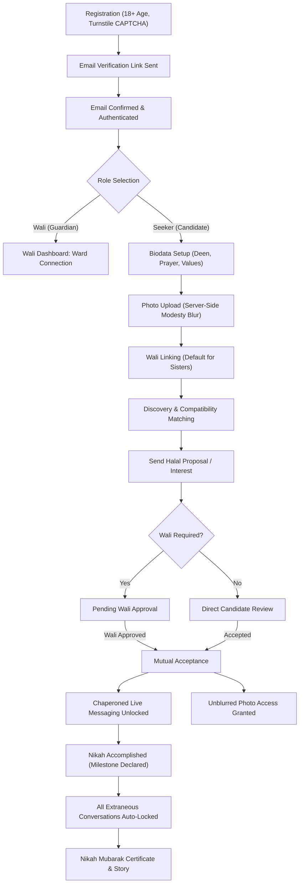
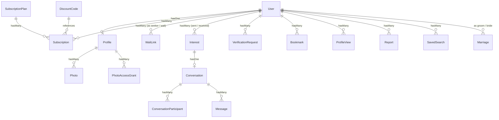

# 💍 Nikah Connect — System Documentation & Architectural Guidelines

> **Note**: This document provides an exhaustive reference for the Nikah Connect (Global Nikkah) platform architecture, business workflows, database schemas, user permissions, and security engineering.

---

## 📑 Table of Contents
1. [System Overview & Core Philosophy](#1-system-overview--core-philosophy)
2. [Tech Stack & Architecture](#2-tech-stack--architecture)
3. [User Roles & Permissions System](#3-user-roles--permissions-system)
4. [Complete User Lifecycle](#4-complete-user-lifecycle)
   - 4.1 [Registration & Age Integrity](#41-registration--age-integrity)
   - 4.2 [Email Verification & Security](#42-email-verification--security)
   - 4.3 [Profile & Deen Completeness](#43-profile--deen-completeness)
   - 4.4 [Photo Privacy & Server-Side Modesty Blur](#44-photo-privacy--server-side-modesty-blur)
   - 4.5 [Wali Guardian Workflow](#45-wali-guardian-workflow)
   - 4.6 [Discovery & Deen Matching Engine](#46-discovery--deen-matching-engine)
   - 4.7 [Quotas & Subscription Tier Limits](#47-quotas--subscription-tier-limits)
   - 4.8 [Halal Proposal & Interest Requests](#48-halal-proposal--interest-requests)
   - 4.9 [Chaperoned Live Messaging & Moderation Guard](#49-chaperoned-live-messaging--moderation-guard)
   - 4.10 [Bookmarks, Private Family Notes & Profile Visitors](#410-bookmarks-private-family-notes--profile-visitors)
   - 4.11 [Identity Verification & KYC](#411-identity-verification--kyc)
   - 4.12 [Reporting & Blocking Mechanism](#412-reporting--blocking-mechanism)
   - 4.13 [Nikah Milestone & Auto-Close Automation](#413-nikah-milestone--auto-close-automation)
5. [Package & Subscription Engine](#5-package--subscription-engine)
6. [Admin & Moderation Governance Suite](#6-admin--moderation-governance-suite)
7. [Database Models & Entity Relationships](#7-database-models--entity-relationships)
8. [Real-Time Events & Broadcasting](#8-real-time-events--broadcasting)
9. [RESTful API Suite (Sanctum V1)](#9-restful-api-suite-sanctum-v1)
10. [Security, Privacy & GDPR Compliance](#10-security-privacy--gdpr-compliance)

---

## 1. System Overview & Core Philosophy

**Nikah Connect** (also operating as **Global Nikkah**) is a Shariah-conscious matrimonial platform engineered for Muslim singles and families across the globe. In direct contrast to casual dating platforms centered around superficial swiping, Nikah Connect is built to preserve Islamic modesty (*Haya*), foster guardian (*Wali*) involvement, and prioritize spiritual compatibility.

### Core Architectural Pillars:
1. **Active Guardian Involvement (Wali Role)**: Upholds dignity and safety through direct father or Mahram guardian approval before private interaction.
2. **Server-Side Modesty Protection (Haya Safeguards)**: Photos are securely stored in private disks and processed via server-side Gaussian blur; original unblurred photos are accessible only upon mutual consent and Wali clearance.
3. **Deen-First Compatibility Scoring**: Prioritizes 5 daily prayers, Madhab/Fiqh, Quran adherence, Halal dietary consciousness, and family values over superficial appearances.
4. **Supervised Chaperoned Messaging**: Provides guardian visibility into conversations while algorithmically blocking unsolicited external contact sharing (phone numbers, WhatsApp, social handles).
5. **Single Marriage Pass**: Replaces predatory recurring monthly billing traps with a transparent "Active Until Nikah" model.

---

## 2. Tech Stack & Architecture

* **Backend Framework**: Laravel 12.x / 13.x (PHP 8.4)
* **Database Engine**: PostgreSQL 16 (production), MySQL 8.x, and SQLite support
* **Frontend**: Blade Templating, Tailwind CSS v4, Alpine.js, Vite
* **Real-Time Broadcasting**: Laravel Reverb (first-party WebSocket server) + Laravel Echo
* **API & Authentication**: Laravel Sanctum (Stateful session & Bearer tokens)
* **Payment Gateways**:
  - Stripe (Checkout Sessions & Webhook handling)
  - PayPal REST API (v2 Orders, Capture & Webhook handling)
  - Simulated Developer Gateway (Local testing & staging validation)
* **Bot Protection**: Cloudflare Turnstile CAPTCHA
* **Image Processing Engine**: PHP GD Library (automated WebP compression, downscaling, and Gaussian blur caching)

---

## 3. User Roles & Permissions System

The system defines 4 primary user roles:

| Role | Description | Primary Privileges & Responsibilities |
|---|---|---|
| **👑 Super Admin** | System Administrator | Platform configuration, dynamic subscription tier and promo code management, staff appointment, role-based permission delegation, immutable audit trail access. |
| **⚖️ Moderator** | Trust & Safety Staff | Reviews user-submitted government ID cards and selfies (KYC) to issue Verified badges; handles user reports (Warn, Suspend, Ban). |
| **🧔/🧕 Seeker (Groom/Bride)** | Matrimonial Candidate | Biodata completion, candidate discovery, sending/receiving proposals, chaperoned messaging, bookmarks, and visitor insights. |
| **🛡️ Wali (Guardian)** | Guardian (Father, Brother, Uncle) | Reviews, approves, or declines proposals on behalf of their ward; chaperones conversations. Wali accounts are 100% free for life. |

### Moderator Permission Flags:
- `manage_verifications`: Review KYC ID cards and live selfies.
- `manage_reports`: Investigate misconduct and enforce disciplinary actions.
- `view_audit_logs`: Inspect security audit log entries.
- `manage_settings`: Update general platform parameters.

---

## 4. Complete User Lifecycle

---

### 4.1 Registration & Age Integrity
- **Routes**: `GET /register`, `POST /register` (`AuthController::register`)
- **Age Restriction**: Enforces a strict minimum age of 18 (`before_or_equal: 18 years ago`).
- **Case-Insensitive Email**: Normalizes and trims emails to lowercase (`strtolower(trim($email))`) to prevent duplicate or spoofed accounts.
- **Turnstile CAPTCHA**: Validates bot challenge tokens during form submission.
- **Phone Formatting**: Normalizes contact numbers to standard international E.164 syntax.

### 4.2 Email Verification & Security
- Dispatches signed `WelcomeVerificationNotification` immediately upon registration.
- Blocks dashboard access until the signed link is confirmed (`auth`, `verified` middleware).

### 4.3 Profile & Deen Completeness
- **Calculation Engine**: `Profile::updateCompleteness()`
- Profiles earn discovery ranking weight according to a 100-point scale:
  - **Deen Information (40 pts)**: Madhab (15 pts), 5 Daily Prayers regularity (15 pts), Halal diet (5 pts), Quran familiarity (5 pts).
  - **Personal Details (25 pts)**: Bio (10 pts), Height (5 pts), Education (5 pts), Profession (5 pts).
  - **Location (10 pts)**: City (5 pts), Country (5 pts).
  - **Family Values (10 pts)**: Family religious practice (5 pts), Joint vs Nuclear living preference (5 pts).
  - **Lifestyle & Preferences (15 pts)**: Partner preferences (10 pts), Approved photo upload (5 pts).

### 4.4 Photo Privacy & Server-Side Modesty Blur
- **Controller**: `PhotoController::show`
- **Private Storage**: All photos reside in Laravel's `private` disk outside the public document root.
- **Image Optimization**: `ImageOptimizationService` converts images to WebP format up to 1600px resolution.
- **Access Control & Blur Engine**:
  1. Profile owner, Admins, and Moderators always receive the original image.
  2. If mutual proposal acceptance is active (`status = accepted`) and Wali clearance is satisfied, the unblurred photo is served.
  3. Otherwise, the server applies an on-the-fly server-side Gaussian blur filter and serves cached blurred WebP binaries.
  4. Original unblurred photos cannot be inspected or intercepted via browser network tools.

### 4.5 Wali Guardian Workflow
- **Service**: `WaliWorkflowService`
- **Rules**:
  - Sister accounts enable `wali_required = true` by default.
  - Sisters can invite their father, brother, or Mahram guardian via signed invitation links (`/wali/invite/{token}`).
  - Wali signups automatically establish linked oversight.
- **Permission Tiers**:
  1. `view_only`: Wali reviews biodata and proposals; ward retains final consent.
  2. `approve_required`: Guardian must approve before proposals proceed to chat.
  3. `full_proxy`: Guardian actively manages and responds to all proposals on ward's behalf.

### 4.6 Discovery & Deen Matching Engine
- **Service**: `MatchingEngineService::computeCompatibility`
- Evaluates candidate compatibility using a comprehensive 100-point Deen Index:
  1. **Religious Alignment (45 pts)**: Madhab/Fiqh congruence (20 pts), Prayer consistency (15 pts), Halal diet (5 pts), Quran familiarity (5 pts).
  2. **Family & Living Alignment (20 pts)**: Joint vs nuclear preference (10 pts), family religiosity level (10 pts).
  3. **Geographic Proximity (15 pts)**: Country match (10 pts), city match (additional 5 pts).
  4. **Education & Career (10 pts)**: Equivalent educational and occupational alignment.
  5. **Age Compatibility (10 pts)**: Fits declared partner age bracket.
- **Discovery Safeguards**:
  - Strict opposite-gender filtering.
  - Married members are automatically excluded from discovery.
  - Blocked profiles are suppressed bidirectionally.

### 4.7 Quotas & Subscription Tier Limits
- **Service**: `QuotaService`
- **Free Seeker Tier**:
  - Up to 10 daily profile views.
  - Up to 5 daily interest requests.
  - Standard filters (age, country, marital status).
- **Pro / Barakah Pass (Single Nikah Pass)**:
  - Unlimited profile views and interest requests.
  - Advanced Deen filters (prayer regularity, Madhab, Quran knowledge).
  - Profile visitor analytics ("Who viewed my profile").
  - Shortlist bookmarks with private family notes.
  - Incognito profile browsing mode.

### 4.8 Halal Proposal & Interest Requests
- **Controller**: `InterestController`
- Enables members to send dignified introduction proposals with personalized notes.
- **Workflow**:
  - If no Wali dependency: Recipient can directly Accept or Decline.
  - If Wali required: Proposal routes to guardian queue for approval before opening conversation.

### 4.9 Chaperoned Live Messaging & Moderation Guard
- **Service**: `MessageModerationService`
- **Real-Time Communication**: Broadcasts via Laravel Reverb (`conversation.{id}` private channel).
- **Wali Presence**: Guardians can monitor active message threads. A top chaperone banner reminds participants: *"In accordance with Islamic modesty, this conversation is supervised by the guardian."*
- **Contact Info & Safety Shield**:
  1. **Email Detection**: Replaced with `[Contact Info Hidden]`.
  2. **Phone Numbers**: Replaced with `[Phone Number Hidden]`.
  3. **Social Handles**: WhatsApp, Telegram, Instagram links replaced with `[External Handle Hidden]`.
  4. **Inappropriate Content**: Flagged and filtered automatically.

### 4.10 Bookmarks, Private Family Notes & Profile Visitors
- **Bookmarks**: Pro subscribers can shortlist profiles and record family evaluation notes.
- **Profile Visitors**: Pro members can inspect visitor activity and mutual compatibility scores.
- **Incognito Mode**: Allows discreet profile viewing without registering on the candidate's visitor log.

### 4.11 Identity Verification & KYC
- Members upload government-issued ID (National ID, Passport, Driver's License) along with a verification selfie.
- Moderators inspect submissions in a live queue.
- Approved profiles display a prominent **✓ Verified** badge.

### 4.12 Reporting & Blocking Mechanism
- **Block**: Instantly severs communication, hides profiles from discovery, and revokes photo permissions.
- **Report**: Logs misconduct with conversation context directly into the moderation console for enforcement (Warning, Suspension, Permanent Ban).

### 4.13 Nikah Milestone & Auto-Close Automation
- **Service**: `MarriageCompletionService`
- When a couple marries, either party initiates the marriage milestone (`marriages.initiate`).
- Upon confirmation by the spouse or guardian, the system executes automated protections:
  1. Both profiles update to **Married**.
  2. Profiles are permanently delisted from discovery.
  3. All other open proposals are automatically closed (`status = closed_married`).
  4. Existing outside chats become permanently read-only (`locked_reason = candidate_married`).
  5. Extraneous photo access grants are revoked.
  6. The couple unlocks the Nikah Mubarak portal (`/nikah-mubarak`) to view their digital certificate and share their success story.

---

## 5. Package & Subscription Engine

Nikah Connect implements a fair, one-time **"Single Marriage Pass"** model active until successful marriage completion.

### Key Capabilities:
1. **Dynamic Package Builder (`/admin/packages`)**: Manage pricing, quota allowances, and feature flags.
2. **Promo Codes & Discounts (`/admin/promo-codes`)**: Issue percentage or fixed discounts with usage caps and expiry dates.
3. **Multi-Gateway Payment Integration (`/admin/payment-settings`)**:
   - Stripe Checkout and webhook handling.
   - PayPal Orders and webhook verification.
   - Simulated gateway for developer and demonstration testing.
   - 1-click gateway connection diagnostics.

---

## 6. Admin & Moderation Governance Suite

Protected under the `/admin` prefix with strict role-based authorization.

### Core Modules:
1. **Live KPI Dashboard (`/admin`)**: Total members, gender distribution, active conversations, verification queues, and platform revenue.
2. **KYC Verification Queue (`/admin/verifications`)**: Secure inspection and adjudication of identity documentation.
3. **User Reports & Compliance (`/admin/reports`)**: Investigation of reported violations with context.
4. **Immutable Audit Trail (`/admin/audit-logs`)**: Security log tracking administrative actions, user IDs, IP addresses, and timestamps.
5. **Staff Delegation (`/admin/staff`)**: Super Admin appointment of moderators and granular permission management.
6. **Security Settings (`/admin/settings`)**: Turnstile CAPTCHA configuration and operational parameters.

---

## 7. Database Models & Entity Relationships

---

## 8. Real-Time Events & Broadcasting

* **Broadcaster**: Laravel Reverb
* **Private Channel Architecture (`routes/channels.php`)**:
  - `user.{id}`: Individual notifications for proposals, guardian approvals, and profile visits.
  - `conversation.{id}`: Encrypted message transport restricted to the candidate pair, active guardian chaperone, and authorized administrators.
* **Events**:
  - `MessageSentEvent`: Real-time instant delivery without page refresh.
  - `InterestReceivedNotification`: Instant toast notifications and badge counter increments.

---

## 9. RESTful API Suite (Sanctum V1)

Production-ready mobile endpoints:

* **Base URL**: `/api/v1/`
* **Authentication**: `Authorization: Bearer <Sanctum_Token>`

| Method | Endpoint | Description |
|---|---|---|
| `POST` | `/api/v1/auth/register` | New candidate registration |
| `POST` | `/api/v1/auth/login` | Authentication and token generation |
| `GET` | `/api/v1/auth/me` | Current authenticated profile |
| `POST` | `/api/v1/auth/logout` | Revoke current device token |
| `POST` | `/api/v1/auth/logout-all` | Revoke all active sessions |
| `GET` | `/api/v1/discover` | Candidate search and filtering |
| `GET` | `/api/v1/discover/daily-matches` | Daily Deen-compatible candidate matches |
| `GET` | `/api/v1/profiles/{id}` | Detailed candidate profile view |
| `GET` | `/api/v1/interests` | Proposals sent and received |
| `POST` | `/api/v1/interests/{id}` | Dispatch new proposal / interest |
| `POST` | `/api/v1/interests/{id}/respond` | Accept or decline proposal |
| `GET` | `/api/v1/conversations` | Active conversation list |
| `GET` | `/api/v1/conversations/{id}/messages` | Message history for conversation |
| `POST` | `/api/v1/conversations/{id}/messages` | Send moderated message |

---

## 10. Security, Privacy & GDPR Compliance

1. **Security Response Headers (`AddSecurityHeaders` Middleware)**:
   - `X-Content-Type-Options: nosniff`
   - `X-Frame-Options: SAMEORIGIN`
   - `Referrer-Policy: strict-origin-when-cross-origin`
   - `Permissions-Policy: camera=(), microphone=(), geolocation=()`
   - `Strict-Transport-Security: max-age=31536000; includeSubDomains`
2. **Rate Limiting**:
   - Authentication & Password Reset: 10 requests / 1 minute.
   - Registration: 10 requests / 60 minutes.
   - Messaging: 30 requests / 1 minute.
   - Photo Requests: 180 requests / 1 minute.
3. **GDPR Right to Be Forgotten (`AccountDeletionService`)**:
   - Account deletion (`/account/delete`) permanently purges all original photos, KYC documents, cache entries, and profile records.
4. **Account Deactivation**:
   - Temporary pauses automatically delist profiles and revoke photo access grants.

---

## Summary

Nikah Connect unites contemporary web engineering with Islamic modesty and family governance. Every database entity, controller action, and service algorithm is architected to provide an honorable, trustworthy, and effective path toward marriage for Muslims worldwide.
